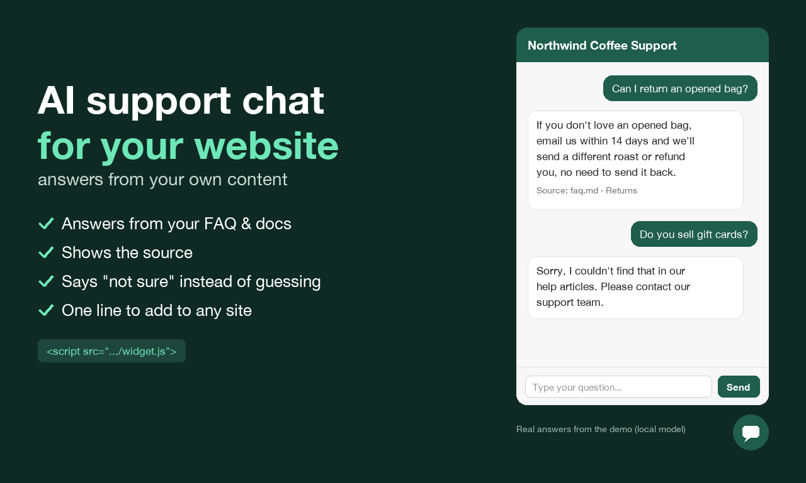

# Website Support Bot

An AI support chat for any website. It answers customer questions from the business's own FAQ and help content, shows which article each answer came from, and says it doesn't know when the content doesn't cover the question.



- **Grounded answers.** The model sees only retrieved help-article excerpts and must cite them. The widget shows `Source: faq.md › Returns` under each answer.
- **Relevance gate.** If nothing in the content scores above `MIN_SCORE` (cosine similarity, default 0.35), the bot replies "couldn't find that" **without calling the LLM**. Off-topic questions cost nothing and can't be made up.
- **One-line embed.** `widget.js` is plain JS (no build step, Shadow DOM so the host site's CSS doesn't leak in).
- **Any LLM.** Any OpenAI-compatible endpoint: OpenAI, Groq, or a local Ollama model. Embeddings run locally (ChromaDB + all-MiniLM-L6-v2).

The demo store, **Northwind Coffee Co.**, is fictional. Its help content is in `samples/`.

## Run it

```bash
uv venv --python 3.12 .venv && source .venv/bin/activate   # tested on 3.12 (chromadb)
uv pip install -r requirements.txt
cp .env.example .env               # pick your LLM provider
set -a; source .env; set +a
python -m app.bot samples/*.md     # ingest the help content (.md, .txt or .pdf)
uvicorn app.main:app --port 8765   # open http://localhost:8765 for the demo store
python test_bot.py                 # no-network test: heading split + relevance gate
```

Markdown is split by heading, so citations point at a section. PDFs are cited by page.

## Add it to a site

```html
<script src="https://your-bot.example.com/widget.js"
        data-api="https://your-bot.example.com"
        data-title="Northwind Coffee Support"
        data-color="#1f5e4b"></script>
```

Set `ALLOWED_ORIGINS=https://your-site.com` on the server so only your site can call it.

## API

| Method | Path | Body | Returns |
|---|---|---|---|
| `POST` | `/ask` | `{"question": "..."}` | `{answer, sources: [{source, location, score}], gated}` |
| `POST` | `/documents` | multipart `file` | `{document, chunks}` |

## Not done yet (production)

Auth on `/documents`, rate limiting, conversation memory for follow-up questions, handoff to a human (email or helpdesk ticket), and chat logs so the owner can see which questions went unanswered.
